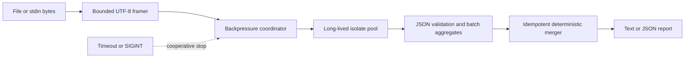

# Dart Concurrency Lab

[](https://github.com/wasiliy-strecker/dart-concurrency-lab/actions/workflows/ci.yml)

Executable Dart concurrency experiments with deterministic tests, benchmarks,
and a production-style streaming CLI.

The repository connects Dart's event loop, Futures, Streams, isolates,
cooperative cancellation, and Zones to one realistic workload. The included
`ndjson_analyzer` processes large newline-delimited JSON event logs without
loading the complete file or creating an isolate per record.

> Version `0.1.0` is a GitHub-only preview. Publication to pub.dev remains
> intentionally disabled until the public API has received external feedback.

## Why this repository

Concurrency examples often stop at `Future.delayed` or `Isolate.run`. Real
tools also need bounded resource use, deterministic output, cancellation while
the source is idle, worker failure recovery, and a clear error contract. This
project makes those properties executable and tested.

The analyzer provides:

- strict, chunk-safe UTF-8 and CRLF framing with a per-line byte bound;
- demand-driven input and a configurable submitted-batch ceiling;
- long-lived parser isolates with one safe retry after a worker exit;
- idempotent aggregation by batch ID, so a retry cannot double count;
- stable text and JSON reports independent of worker completion order;
- deadlines, graceful SIGINT handling, typed progress, and partial reports;
- a sequential engine for correctness comparison and measurement.

## Quick start

```sh
dart pub get
dart run bin/ndjson_analyzer.dart analyze test/fixtures/events.ndjson
```

Read stdin and emit deterministic JSON:

```sh
cat events.ndjson | dart run bin/ndjson_analyzer.dart \
  analyze - --format=json --workers=4 --max-in-flight=8
```

After the GitHub repository is available, the executable can also be activated
directly from Git:

```sh
dart pub global activate --source git \
  https://github.com/wasiliy-strecker/dart-concurrency-lab.git
ndjson_analyzer analyze events.ndjson
```

Example text report:

```text
NDJSON analysis: complete
Lines: 5 (valid 4, invalid 0, blank 1)
Types:
  request.completed: 2
  sync.completed: 1
  sync.started: 1
Durations: count 3, min 18 ms, max 80 ms, mean 46.67 ms
Workers: 0 restarts, peak 2 submitted batches
```

Runtime measurements appear only in text output. JSON output contains the
deterministic report and can be compared byte-for-byte across equivalent runs.

## Input contract

Each non-blank UTF-8 line must be one JSON object.

| Property | Requirement |
| --- | --- |
| `type` | Required non-empty string; surrounding whitespace is normalized |
| `timestamp` | Optional ISO-8601 string; normalized to UTC |
| `duration_ms` | Optional non-negative JSON integer |
| other fields | Allowed and ignored by aggregation |

Malformed UTF-8, oversized lines, invalid JSON, non-object values, and invalid
properties receive stable error codes. Reports never echo source lines or
payload fields.

Use `--strict` to return exit code `1` when any record is invalid. Run
`ndjson_analyzer analyze --help` for all batching, worker, error, and deadline
options.

## Library API

The CLI is built entirely on the public streaming API:

```dart
import 'dart:io';

import 'package:dart_concurrency_lab/dart_concurrency_lab.dart';

final run = const NdjsonAnalyzer().start(
  File('events.ndjson').openRead(),
  options: AnalysisOptions.forProcessors(Platform.numberOfProcessors),
);

final progress = run.progress.listen((value) {
  print('${value.linesRead} lines; ${value.inFlightBatches} batches active');
});

final report = await run.done;
await progress.cancel();
print(report.toJson());
```

`AnalysisRun.cancel()` stops source demand, completes already submitted batches,
and returns an explicitly partial report. It does not pretend to stop an
arbitrary synchronous Dart function halfway through an instruction.

## Architecture



The main isolate owns input ordering, pressure, lifecycle, and final merging.
Workers receive bounded, independently retryable batches and return aggregates
instead of every parsed payload. See [architecture](docs/architecture.md) and
[failure and cancellation semantics](docs/failure-and-cancellation.md).

## Executable labs

| Lab | Contract demonstrated |
| --- | --- |
| `event_loop.dart` | synchronous work, microtasks, and event-queue ordering |
| `bounded_futures.dart` | eager `Future.wait` versus a concurrency ceiling |
| `stream_backpressure.dart` | demand-driven single-subscription streams |
| `isolate_transfer.dart` | transferable bytes and isolate memory boundaries |
| `cooperative_cancellation.dart` | explicit cancellation checks and cleanup |
| `zoned_failures.dart` | capture of otherwise unawaited asynchronous errors |

Every lab contains an internal assertion and is executed by the test suite. The
[decision guide](docs/async-decision-guide.md) explains when each mechanism is
appropriate.

## Verification and benchmarks

```sh
make check
make coverage
make docs
```

The seeded benchmark verifies report equivalence before displaying timings:

```sh
dart run benchmark/pipeline_benchmark.dart \
  --events=100000 --runs=3 --workers=4
```

Benchmarks deliberately have no CI speed threshold. Their purpose and limits
are documented in [benchmarking](docs/benchmarking.md).

CI runs formatting, strict analysis, all tests, the executable labs, an AOT CLI
build, an 80% library line-coverage floor, a CLI smoke test, and a benchmark
smoke run. Tests execute on Linux, macOS, and Windows.

## Exit codes

| Code | Meaning |
| ---: | --- |
| `0` | complete report |
| `1` | invalid input records with `--strict` |
| `64` | CLI usage or option error |
| `66` | input file or byte-stream failure |
| `70` | internal or exhausted worker failure |
| `124` | configured timeout |
| `130` | SIGINT cancellation |

## Scope

- Dart VM platforms only: Linux, macOS, and Windows.
- No network requests, persistence, or payload collection.
- Not a general JSON Schema validator and not a log-storage system.
- Throughput depends on input shape, hardware, Dart version, and worker count;
  more isolates are not automatically faster.

## License

MIT. See [LICENSE](LICENSE).
