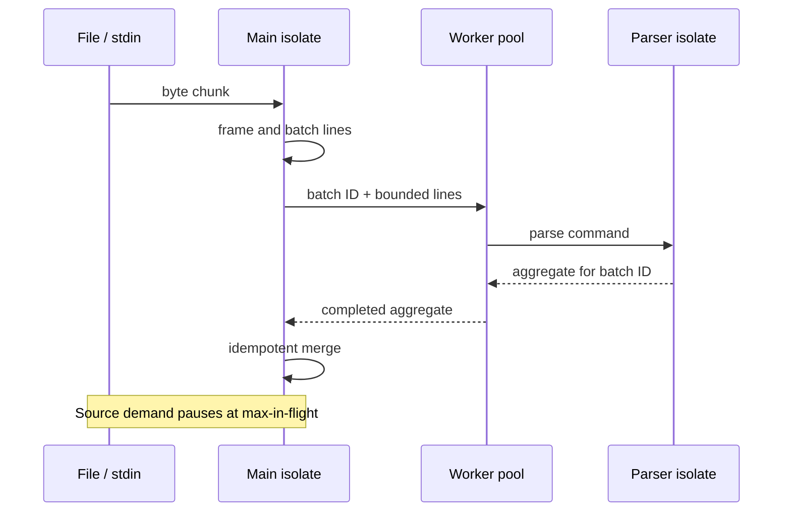

# Architecture

## Responsibilities

The main isolate owns all lifecycle-sensitive state:

1. frame arbitrary byte chunks into bounded UTF-8 lines;
2. pause source demand when submitted work reaches the configured ceiling;
3. assign monotonically increasing batch IDs;
4. merge each completed batch ID at most once;
5. produce progress snapshots and the final report;
6. translate cancellation or a deadline into a partial completion status.

Parser isolates own no application state. Each receives a bounded list of
decoded lines and returns only mergeable aggregates: counts, time bounds,
duration totals, a bounded slow-event list, and bounded error details. Payloads
are not returned to the main isolate.

## Data flow

## Backpressure and memory

The coordinator does not request another input chunk while it is waiting for a
batch slot. A run therefore retains approximately:

- one source chunk and one partially assembled line;
- one incomplete batch;
- at most `maxInFlightBatches × batchSize` submitted lines;
- counts per distinct event type;
- `maxErrors` diagnostics and `slowestEventLimit` slow-event summaries.

The complete file and complete payload set are never retained. Event-type
cardinality remains input-dependent and is stated explicitly rather than hidden
behind a false constant-memory claim.

## Determinism

Workers may finish in any order. Determinism comes from commutative aggregates
and explicit final ordering:

- type keys sort lexicographically;
- validation errors sort by physical line;
- slow events sort by descending duration and then ascending line;
- timestamps use UTC;
- runtime duration and throughput are excluded from JSON.

Batch IDs also make retry merging idempotent. A stale duplicate completion is
ignored rather than counted twice.

## Worker lifecycle

Workers are started once per analysis run and reused for many batches. If a
worker exits unexpectedly, its uncommitted batch returns to the front of the
queue and a replacement worker starts. The batch gets one retry. A second
failure becomes a typed terminal error instead of an infinite restart loop.

Normal JSON and schema failures are data outcomes, not worker crashes.
